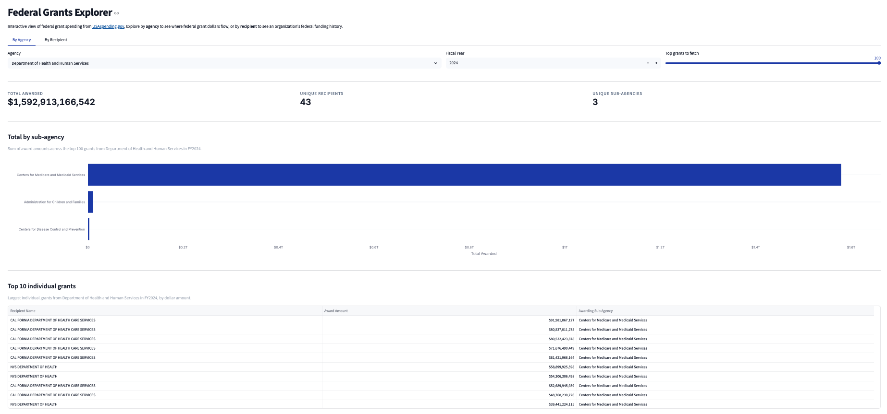
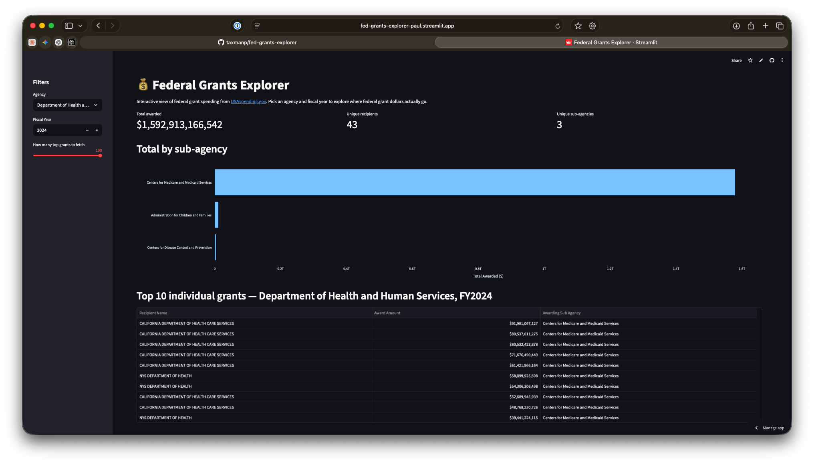

# Federal Grants Explorer

[Live demo](https://fed-grants-explorer-paul.streamlit.app) · [USAspending.gov](https://www.usaspending.gov/)

A focused dashboard for grants teams, program officers, and analysts exploring federal grant obligations by awarding agency or recipient search. Built from experience in federal grants management at the U.S. Department of Health and Human Services.

## What it does

- **By Agency:** Choose an awarding agency and federal fiscal year. See net obligations on matching transactions in that period, then explore a bounded list of individual awards and their lifetime obligations by sub-agency.
- **By Recipient:** Search recipient or parent-recipient names, UEIs, or DUNS across fiscal years. See period net obligations, a fiscal-year breakdown, and individual award details with recipient UEIs and award IDs.
- **Transparent coverage:** The detail list loads up to 100, 250, 500, or 1,000 unique awards. Result limits, failed pages, inconsistent pagination, and time/page budgets are visible. The fiscal-period total is aggregated by USAspending independently of that cap.

No API key is required. This is an exploration tool, not a complete bulk download, accounting reconciliation, or verified organizational funding history.

## Read the metrics correctly

| Metric or view | Definition and scope |
| --- | --- |
| **Period net obligations** | `/search/spending_over_time/`, explicitly `spending_level: transactions`, grouped by fiscal year. Sums matching transaction obligations and deobligations with **action dates inside the selected period**. Includes all matches available to that API, not just the award rows loaded. |
| **Awards loaded** | Count of unique award records actually retained, deduplicated by `generated_internal_id`. Not the number of grants awarded during the period and not a total matching-record count. |
| **Loaded awards: lifetime obligations** | Sum of the API's `Award Amount` for the retained records. That field maps to cumulative `total_obligation` across each award's transactions. It can include activity before and after the selected fiscal years. |
| **Loaded-award agency charts** | Lifetime obligations grouped across the retained award rows only. Missing agencies remain in an “Unknown agency” bucket. These charts are not full-period spending distributions. |
| **Net obligations by fiscal year** | The transaction aggregate for each selected FY, independent of the award list. A missing FY bucket in a valid aggregate response is shown as zero. A failed/malformed request is “Unavailable,” never zero. |
| **Performance start date** | The award's period-of-performance start date (`Start Date`), not a transaction action date. It is not used to allocate obligations to years. |

### Why the two dollar metrics do not reconcile

USAspending's default **award search** date filter finds awards whose latest transaction date is on/after the selection start and whose base award date is on/before the selection end. This is an **activity-span overlap**, not a transaction-in-period test and not period-of-performance overlap. An award can appear without a transaction in the selected FY. Its amount is still a lifetime amount.

The **transaction aggregate** instead constrains individual transaction action dates to the selected dates. It is the appropriate source for period obligations. No award-list sum is used as a fallback if the aggregate fails.

### Other scope notes

- Prime grant/cooperative-agreement award types **02, 03, 04, 05** only. No contracts, loans, direct payments, or subawards.
- Federal FY2024 means **October 1, 2023 through September 30, 2024**, inclusive. FY choices update automatically at October 1 (UTC). The default is the latest completed federal FY. FY2008 is the earliest search year supported here.
- The current FY is incomplete. Reporting delays and later corrections affect current and historical data. Retrieval time is shown; it is not the underlying dataset's refresh date.
- Obligations are commitments, **not cash payments or outlays**. Deobligations may make a period or award amount negative.
- Recipient text is USAspending's broad search across recipient **and parent-recipient** names, UEIs, and DUNS. A phrase may match multiple organizations and does not guarantee every affiliate or campus. Check UEIs and award IDs. This app does not assert exact organizational identity.
- Recipient name reformatting is a display-only heuristic for some inverted names. Source names and identifiers remain intact in the client result.
- Independent endpoints and pages are not a transactional snapshot. Data can change between calls. “No more pages” means only that USAspending reported no next page for that request; it is not a guarantee of complete government reporting.

## Run locally

Requires Python 3.12+ and [uv](https://docs.astral.sh/uv/).

```bash
git clone https://github.com/taxmanp/fed-grants-explorer.git
cd fed-grants-explorer
uv sync --locked
uv run streamlit run app.py

# Small command-line example: HHS FY2024, at most 100 award details
uv run python main.py
```

Select filters and submit the relevant form. Editing filters alone does not issue searches; the results retain their submitted query label. Use **Refresh these results** to clear the relevant cached aggregate and award search. A failed agency directory does not disable recipient lookup.

### Request bounds and error handling

- At most **100 records per page**, **10 pages**, **1,000 retained awards** per search. The default is 100. This is an app limit, not USAspending's full dataset size.
- A 90-second budget is checked **between** page requests. An in-flight request and its retries can exceed that interval; this is not a strict wall-clock timeout.
- HTTP connection timeout 5 seconds; read timeout 30 seconds. At most two retries for transient connection/read errors or HTTP 500/502/503/504, with backoff. Read timeout measures socket inactivity, not total response duration.
- Uses the API's returned cursor pair unchanged when present and page-number continuation otherwise. Page width remains constant; excess final-page records are trimmed locally so offsets do not shift.
- Duplicate IDs are removed; overlapping/empty continuation pages and invalid or repeated cursors stop with unverified coverage. Mid-search errors retain validated earlier pages with a partial-result warning. Invalid first pages fail visibly.
- Missing or non-finite monetary fields fail validation rather than silently becoming zero. Negative valid amounts are preserved.
- Responses, including partial award results, are cached for up to one hour. The refresh button lets users retry immediately. API response notices are available in an expander.

## Tests and reproducibility

```bash
uv sync --locked
uv run python -m unittest discover -s tests -v
uv run python -m compileall -q app.py client.py main.py tests

# Optional, isolated offline browser preview with synthetic data
uv run streamlit run tests/preview_app.py
```

The suite runs offline with mocked responses; no API key or live data is needed. Client tests cover pagination, caps, cursors, errors/schema drift, fiscal-year boundaries, negative obligations, aggregate semantics, and display helpers. Streamlit AppTest tests cover both views, independent source failures, partial and empty results, refresh/repeated submissions, blank recipient searches, and current-year warnings. Mocks are not live API verification; see `docs/verification.md` for the pre-release and live-deployment checks and their limits.

Dependencies are captured in `uv.lock`. No SQL/database is required for this API-backed design. No deployment or publication is performed by the test commands.

## Source-backed API definitions

Semantics checked against the official USAspending implementation at commit `03b9e2554837998c4c261c65e2947dc79f23855a`:

- [Time-period filter contract](https://github.com/fedspendingtransparency/usaspending-api/blob/03b9e2554837998c4c261c65e2947dc79f23855a/usaspending_api/api_contracts/search_filters.md#L188-L235)
- [Award amount field mapping](https://github.com/fedspendingtransparency/usaspending-api/blob/03b9e2554837998c4c261c65e2947dc79f23855a/usaspending_api/awards/v2/lookups/elasticsearch_lookups.py#L173-L186)
- [Transaction aggregate contract](https://github.com/fedspendingtransparency/usaspending-api/blob/03b9e2554837998c4c261c65e2947dc79f23855a/usaspending_api/api_contracts/contracts/v2/search/spending_over_time.md)
- [Recipient and parent search implementation](https://github.com/fedspendingtransparency/usaspending-api/blob/03b9e2554837998c4c261c65e2947dc79f23855a/usaspending_api/common/query_with_filters.py#L308-L407)
- [Award pagination implementation](https://github.com/fedspendingtransparency/usaspending-api/blob/03b9e2554837998c4c261c65e2947dc79f23855a/usaspending_api/search/v2/views/spending_by_award.py#L613-L671)
- [Current API documentation](https://api.usaspending.gov/)

## Historical design references

These screenshots show the previous UI and its old labels; they are retained only as design references, not evidence of the corrected metrics. Their original README captions were swapped.

<details>
<summary>Previous agency view</summary>



</details>

<details>
<summary>Previous recipient view</summary>



</details>

## Roadmap

- [x] Agency and recipient exploration with resilient requests
- [x] Separate fiscal-period obligations from lifetime award details
- [x] Bounded pagination and visible result coverage
- [x] Automated client and Streamlit regression tests
- [ ] Server-aggregated sub-agency/geographic breakdowns for period obligations
- [ ] Exact-recipient selection using verified USAspending recipient identities
- [ ] Bulk-download workflow for analysis beyond the interactive cap

## About the author

Built by Paul Rodriguez, a finance and analytics professional with experience in federal grants management, Big Four tax, and international finance consulting. [LinkedIn](https://www.linkedin.com/in/paulrodriguez5/) · [GitHub](https://github.com/taxmanp)
